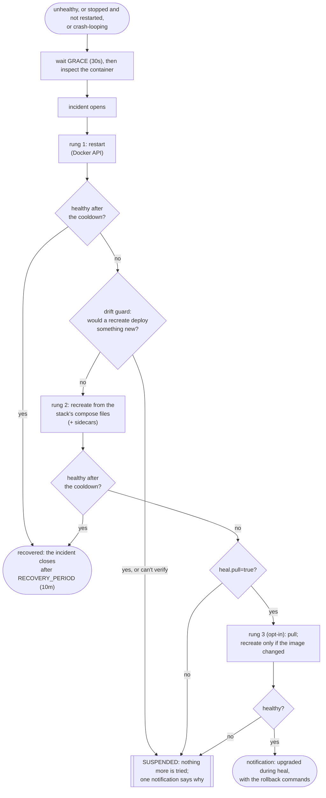

<p align="center">
  
</p>

# whalenurse

**Compose-aware self-healing for Docker hosts.**

[](https://github.com/jackspiering/whalenurse/actions/workflows/ci.yml)
[](LICENSE)

When an opted-in container turns unhealthy, or stops and stays stopped, whalenurse restarts it. If that doesn't help, it
**recreates it from the stack's own compose files**, together with the `network_mode: service:` sidecars that depend on it. If that
fails too, it stops trying, **tells you why**, and leaves the container alone until you say so.

Docker doesn't restart unhealthy containers, and a restart policy gives up for good when a start fails, which is common at boot
when a mount or network isn't ready yet. Tools like autoheal restart containers. whalenurse is for what a restart can't fix.

## What makes it different

- **Compose-aware recreate.** It rebuilds a broken container from the project, files and env file that compose recorded on it, with
  `up -d --no-deps --pull never --no-build <service>`. It never runs `compose down`, which would remove the shared project network.
- **`network_mode` sidecars.** A sidecar that shares its parent's network namespace breaks whenever the parent restarts or is
  recreated, and it usually stays "running" with only a loopback interface, so nothing notices. whalenurse finds those, repairs
  them in the right order (restart if the parent only restarted, recreate if its ID is gone) and never restarts one whose parent
  is gone, which would turn it from broken into dead.
- **A drift guard.** A recreate deploys whatever is on disk and in the local image store *now*. If you edited the compose file
  and haven't deployed it, or another stack moved the image tag, a "heal" would silently ship that. whalenurse checks first
  (compose's own dry run, the config hash, the image ID) and, on a mismatch, refuses, says why and suspends.
- **Never upgrades by accident.** Every recreate is `--pull never --no-build`. Only an opt-in last rung pulls, and then it says
  what it upgraded and prints the exact rollback.
- **Decides from the container, not the event order.** Docker's events are only triggers; whalenurse inspects the container
  after a grace period. It copes with daemon restarts and reboots (a host shutdown stopping your containers is not a crash).
- Plus the table stakes: opt-in labels, a cooldown and flap limit, a global rate limit, pause, `--dry-run`, notifications
  (ntfy, Gotify, Discord, Telegram and more via Shoutrrr), and a read-only dashboard.

<p align="center">
  <picture>
    <source media="(prefers-color-scheme: dark)" srcset="docs/screenshots/overview-desktop-dark.png">
    
  </picture>
</p>

## Try it in 2 minutes

A demo stack with whalenurse, [bop](https://github.com/jackspiering/bop) (a container that fails on demand) and a sidecar that
shares bop's network. You'll break bop and watch whalenurse restart it, then recreate it, then bring the sidecar back.

You need a Linux host with Docker Engine 28.1 or later and the Compose plugin v5.2.0 or later (`docker version`, `docker compose version`).
The demo only touches its own project, `whalenurse-demo`.

```sh
git clone --depth 1 https://github.com/jackspiering/whalenurse && cd whalenurse/examples/demo
printf 'DOCKER_GID=%s\nDEMO_DIR=%s\n' "$(stat -c %g /var/run/docker.sock)" "$PWD" > .env
docker compose up -d
```

> **Before the first release is published** (check the [releases](https://github.com/jackspiering/whalenurse/releases)), the image
> isn't on GHCR yet. Build it first: `docker build -t whalenurse:dev ../..` from the demo directory, and add
> `WHALENURSE_IMAGE=whalenurse:dev` to `.env`. Also, if the host's compose plugin isn't at
> `/usr/libexec/docker/cli-plugins/docker-compose` (`docker info` shows where it is), set `COMPOSE_PLUGIN` in `.env`.

Open **http://localhost:8484**: the dashboard, on loopback only. Then break bop so that a restart can't fix it:

```sh
docker compose exec bop bop unhealthy sticky=true
docker compose logs -f whalenurse
```

Within about a minute you'll see it open an incident, **restart** bop (still unhealthy, because the broken mode is sticky), wait,
**recreate** bop from the compose file (a fresh container, healthy again), and recreate the sidecar behind it. The dashboard
shows the same as a timeline. Clean up with `docker compose down -v`.

Notes: the demo uses short timings (a 5 s grace, a 10 s cooldown); the defaults are 30 s each. The demo file is checked in CI
against the image built from each commit.

## How it works



- **One pass per incident.** Each rung runs once, with a growing cooldown between them. When they're spent the container is
  SUSPENDED and you get one message with the cause and the command to lift it (`whalenurse unsuspend`). It also clears if the
  container recovers, someone recreates it, or someone starts it by hand after stopping it.
- **Flapping is a failure too.** More than 3 incidents in 24 h suspends a container even if each one recovered.
- **PAUSED is separate**: `whalenurse pause <project>/<service> --for 2h` for maintenance; it expires so a forgotten pause
  can't disable healing for good.
- **A rate limit** (10 actions an hour, host-wide) stops an action storm during a host-wide outage.
- **Events are only triggers.** The poll (60 s) is the safety net: a failed restart by the restart policy emits no event at all.
- **A host shutdown isn't a crash.** A container that a daemon restart or reboot stopped is judged by its restart policy (a
  `restart: "no"` container stays down, with one notification); Docker's own restore is left to Docker.
- **Rungs 2 and 3 are gated by versions**, checked at start: Engine 28.1 and Compose v5.2.0, below which it restarts only.

The design, with every rule and the evidence for it, is in [docs/PLAN.md](docs/PLAN.md).

<p align="center">
  <picture>
    <source media="(prefers-color-scheme: dark)" srcset="docs/screenshots/detail-suspended-desktop-dark.png">
    
  </picture>
</p>

*A container the drift guard stopped: its compose file changed after it was created, so a recreate would have deployed the edit.
whalenurse restarted it, refused to recreate it, and suspended it with the command to lift that.*

## Use it

1. **Run it** (container: [examples/minimal](examples/minimal/compose.yaml) or [examples/full](examples/full/compose.yaml); or
   [systemd](docs/deployment.md#under-systemd)). Start with `WHALENURSE_DRY_RUN=true`: it logs and notifies what it would do.
2. **Opt containers in**, in their compose files, then `docker compose up -d`:
   ```yaml
   services:
     web:
       labels:
         whalenurse.enable: "true"
   ```
3. **Check it:** `docker exec whalenurse /whalenurse status`, and `docker exec whalenurse /whalenurse notify test`.

For recreate in a container you mount two things read-only: **the host's compose plugin** at `/host/docker-compose` and **the
stacks root at the identical path** as on the host (`/opt/stacks:/opt/stacks:ro`). Without them it restarts, says why it can't
recreate, and suspends. [docs/deployment.md](docs/deployment.md) has the details.

### The CLI

```sh
docker exec whalenurse /whalenurse status [--json]
docker exec whalenurse /whalenurse pause <project>[/<service>] [--for 2h]
docker exec whalenurse /whalenurse resume <project>[/<service>]
docker exec whalenurse /whalenurse unsuspend <project>[/<service>]
docker exec whalenurse /whalenurse notify test
```

It talks to the daemon over a local unix socket; there are no write endpoints on the network.

## Configuration

Environment variables (`WHALENURSE_*`) on whalenurse, labels (`whalenurse.*`) on containers. The common ones:

| Variable | Default | |
|---|---|---|
| `WHALENURSE_DRY_RUN` | `false` | log and notify only |
| `WHALENURSE_MODE` | `label` | `all` opts in every container except `whalenurse.enable=false` |
| `WHALENURSE_GRACE` / `_COOLDOWN` | `30s` / `30s` | wait before deciding / between rungs (doubles per rung) |
| `WHALENURSE_FLAP_LIMIT` / `_FLAP_WINDOW` | `3` / `24h` | flapping suspends |
| `WHALENURSE_RATE_LIMIT` | `10` | actions per hour |
| `WHALENURSE_DRIFT_GUARD` | `strict` | `warn` recreates despite verified drift and says so |
| `WHALENURSE_NOTIFY_URLS` | — | [Shoutrrr](https://nicholas-fedor.github.io/shoutrrr/) URLs; **secret** |
| `WHALENURSE_HTTP_ADDR` | — (off) | the dashboard and read-only API |
| `WHALENURSE_HTTP_TOKEN` | — | **secret**; bearer or Basic password |
| `WHALENURSE_DATA_DIR` | `/data` | the state store |

| Label | Values | |
|---|---|---|
| `whalenurse.enable` | `true` / `false` | opt in / never touch (also as a sidecar) |
| `whalenurse.actions` | `restart,recreate` (default) | the rungs |
| `whalenurse.heal.pull` | `true` | adds rung 3, the pull; needs `recreate` |
| `whalenurse.heal-exited` | `crashed` (default), `always`, `never` | what to do with an exited container |
| `whalenurse.cooldown`, `whalenurse.flap-limit` | | per-container overrides |

**Every variable with its default: [docs/configuration.md](docs/configuration.md). Every label: [docs/labels.md](docs/labels.md).**

## Security

- **Mounting `docker.sock` is root-equivalent on the host.** whalenurse acts only on opted-in containers and runs a fixed set of
  compose commands, but you are still giving it the socket. Run it `read_only` with `cap_drop: [ALL]`; mount the stacks and the
  compose plugin `:ro`. [docs/security.md](docs/security.md) says what it does with it.
- **The dashboard is off by default and read-only** (GET and HEAD only). Expose it on `127.0.0.1`, behind a TLS reverse proxy, or
  on your tailnet through a Tailscale container **on a shared bridge network** (`tailscale serve`; see
  [examples/full](examples/full/compose.yaml)). **Never `network_mode: service:tailscale`**: whalenurse would become a dependent
  of a container it may heal. Set a token for anything but loopback, and use TLS, because the token travels in clear.
- **Notification URLs and the token are secrets.** They are never logged or shown; keep them in an env file that stays out of git.
- Releases are signed (cosign, keyless) and carry provenance and SBOMs: [docs/verifying-releases.md](docs/verifying-releases.md).
- Report a vulnerability privately: [SECURITY.md](SECURITY.md).

## Requirements and known limits

- **Docker Engine 25 or later** for the restart rung. **Engine 28.1 or later and Docker Compose v5.2.0 or later** for recreate,
  the pull and the drift guard; below that whalenurse says so once, and the ladder ends after the restart. Linux, `amd64` or
  `arm64`.
- The Docker Compose plugin on the host (mounted read-only), or the copy bundled in the image.
- Compose stacks in plain directories on the host.
- **Known limits:** the pull rung cannot use a private registry (no credentials in the container; planned); one host per
  whalenurse (a multi-host hub is a later project); no write controls in the dashboard (the CLI does that); the dashboard has been
  tested in headless Chromium, not on every phone.

## Documentation

[Configuration](docs/configuration.md) · [Labels](docs/labels.md) · [Deployment](docs/deployment.md) ·
[Security](docs/security.md) · [Troubleshooting](docs/troubleshooting.md) ([why is it SUSPENDED?](docs/troubleshooting.md#why-is-my-container-suspended),
[drift messages](docs/troubleshooting.md#drift-block-messages)) · [Upgrading](docs/upgrading.md) ·
[Verifying a release](docs/verifying-releases.md) · [Changelog](CHANGELOG.md) · [Contributing](CONTRIBUTING.md) ·
[The design](docs/PLAN.md)

## Status

Built milestone by milestone against a written design and tested against real Docker in CI on both image stores and three
Compose releases. The first release (v0.1.0) waits on a few days of dry-run on the maintainer's own host: see
[docs/releasing.md](docs/releasing.md#the-release-gate).

## License

MIT
