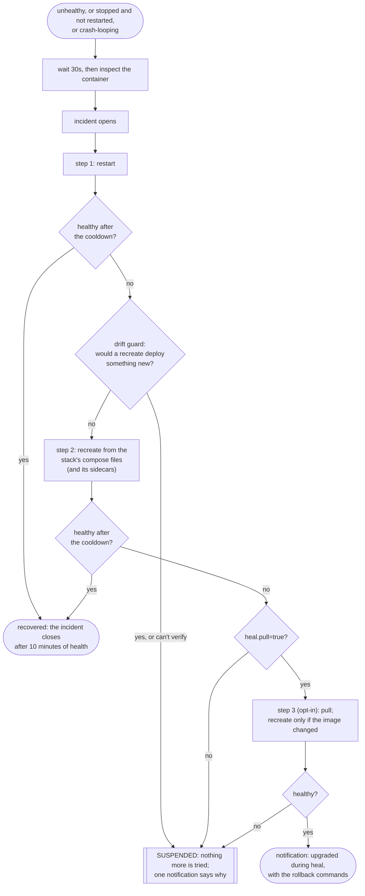
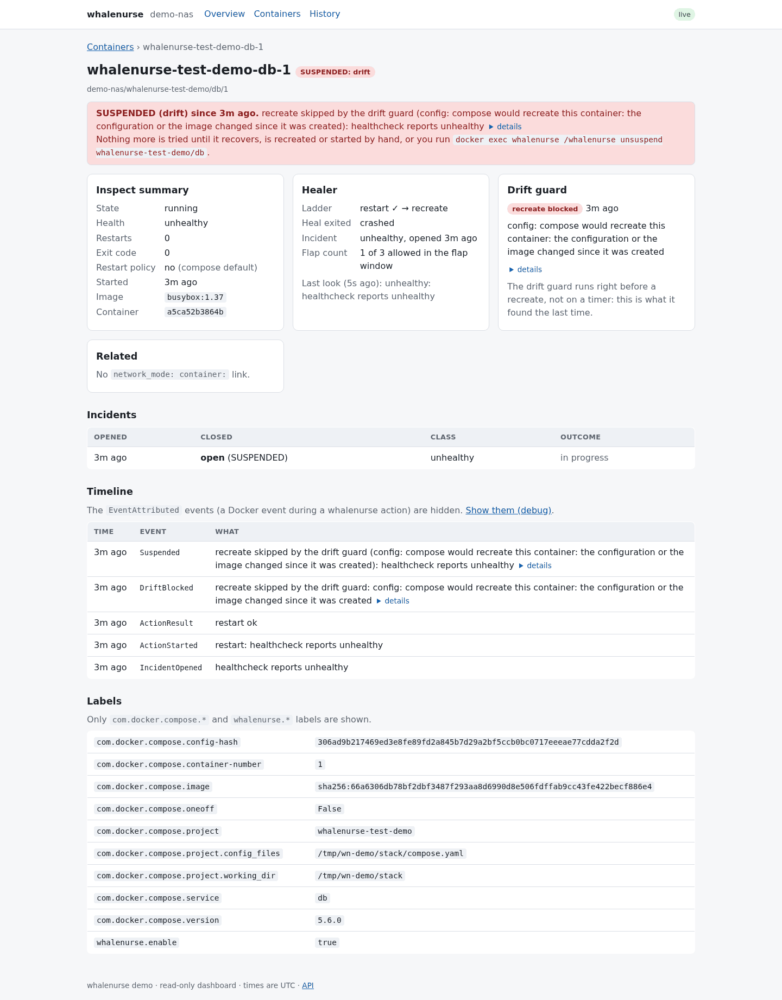

<p align="center">
  
</p>

# whalenurse

**Compose-aware self-healing for Docker hosts.**

[](https://github.com/jackspiering/whalenurse/actions/workflows/ci.yml)
[](LICENSE)

When an opted-in container turns unhealthy, or stops and stays stopped, whalenurse restarts it. If that doesn't help, it
recreates it from the stack's own compose files, together with the `network_mode: service:` sidecars that depend on it. If that
fails too, it stops trying, tells you why, and leaves the container alone until you say so.

Docker doesn't restart unhealthy containers, and a restart policy gives up for good when a start fails, which is common at boot
when a mount or network isn't ready yet. Tools like autoheal restart containers. whalenurse is for what a restart can't fix.

- **Compose-aware recreate.** A broken container is rebuilt from the project, files and env file compose recorded on it. It never
  runs `compose down`, which would remove the shared project network.
- **Sidecars.** Containers that share a parent's network break when the parent restarts or is recreated, and usually stay
  "running" with nothing to show for it. whalenurse finds them and repairs them in the right order.
- **A drift guard.** If you edited the compose file and haven't deployed it, or another stack moved the image tag, a recreate
  would silently ship that. whalenurse checks first and, on a mismatch, refuses and says why.
- **No accidental upgrades.** A recreate never pulls. Only an opt-in last step does, and it prints the exact rollback.
- **Shutdowns aren't crashes.** A host reboot or daemon restart stopping your containers isn't treated as a failure.

Also: opt-in labels, a cooldown and flap limit, pause, `--dry-run`, notifications through Shoutrrr (ntfy, Gotify, Discord,
Telegram and more) and a read-only dashboard.

<p align="center">
  <picture>
    <source media="(prefers-color-scheme: dark)" srcset="docs/screenshots/overview-desktop-dark.png">
    
  </picture>
</p>

## Try it in 2 minutes

A demo stack with whalenurse, [bop](https://github.com/jackspiering/bop) (a container that fails on demand) and a sidecar that
shares bop's network. You'll break bop and watch whalenurse restart it, then recreate it, then bring the sidecar back.

You need a Linux host with the Docker requirements [below](#requirements-and-known-limits). The demo's whalenurse acts on every
container that carries `whalenurse.enable=true`, so **don't run it on a host that already runs whalenurse or has opted-in
containers**. A fresh VM or a laptop is fine.

```sh
git clone --depth 1 https://github.com/jackspiering/whalenurse && cd whalenurse/examples/demo
printf 'DOCKER_GID=%s\nDEMO_DIR=%s\n' "$(stat -c %g /var/run/docker.sock)" "$PWD" > .env
docker compose up -d
```

> Until the first release is published, build the image yourself: `docker build -t whalenurse:dev ../..` from the demo
> directory, and add `WHALENURSE_IMAGE=whalenurse:dev` to `.env`. If the host's compose plugin isn't at
> `/usr/libexec/docker/cli-plugins/docker-compose`, set `COMPOSE_PLUGIN` in `.env` (`docker info` shows where it is).

Break bop so that a restart can't fix it:

```sh
docker compose exec bop bop unhealthy sticky=true
docker compose logs -f whalenurse
```

Within about a minute it opens an incident, restarts bop (still unhealthy, because the broken mode is sticky), waits, recreates
bop from the compose file, and recreates the sidecar behind it. Open http://localhost:8484 (loopback only) to see the same thing
as a timeline on bop's page. `docker compose down -v` cleans up. The demo uses short timings (5 s grace, 10 s cooldown); the
defaults are 30 s each.

## How it works



- **One pass per incident.** Each step runs once, with a growing pause between them. When they're spent, the container is
  SUSPENDED and you get one message with the cause and the command to lift it (`whalenurse unsuspend`).
- **Flapping is a failure too.** More than 3 incidents in 24 h suspends a container even if each one recovered.
- **Pause for maintenance:** `whalenurse pause <project>/<service> --for 2h`. A pause expires, so a forgotten one can't disable
  healing for good.
- **A host shutdown isn't a crash.** A container stopped by a daemon restart or reboot is judged by its restart policy: a
  `restart: "no"` container stays down with one notification, and Docker's own restore is left to Docker.
- **A rate limit** of 10 actions an hour, host-wide, stops an action storm during an outage.

<p align="center">
  <picture>
    <source media="(prefers-color-scheme: dark)" srcset="docs/screenshots/detail-suspended-desktop-dark.png">
    
  </picture>
</p>

## Use it

1. **Run it** (container: [examples/minimal](examples/minimal/compose.yaml) or [examples/full](examples/full/compose.yaml); or
   [systemd](docs/deployment.md#under-systemd)). Start with `WHALENURSE_DRY_RUN=true`, which logs and notifies what it would do.
2. **Opt containers in**, in their compose files, then `docker compose up -d`:
   ```yaml
   services:
     web:
       labels:
         whalenurse.enable: "true"
   ```
3. **Check it:** `docker exec whalenurse /whalenurse status`, and `docker exec whalenurse /whalenurse notify test`.

To recreate from a container, mount the host's compose plugin at `/host/docker-compose` and the stacks root at the identical
path as on the host (`/opt/stacks:/opt/stacks:ro`), both read-only. Without them it restarts, says why it can't recreate, and
suspends. See [docs/deployment.md](docs/deployment.md).

### The CLI

```sh
docker exec whalenurse /whalenurse status [--json]
docker exec whalenurse /whalenurse pause <project>[/<service>] [--for 2h]
docker exec whalenurse /whalenurse resume <project>[/<service>]
docker exec whalenurse /whalenurse unsuspend <project>[/<service>]
docker exec whalenurse /whalenurse notify test
```

The CLI talks to the daemon over a local unix socket.

## Configuration

Environment variables (`WHALENURSE_*`) go on whalenurse, labels (`whalenurse.*`) on containers. The common ones:

| Variable | Default | |
|---|---|---|
| `WHALENURSE_DRY_RUN` | `false` | log and notify only |
| `WHALENURSE_MODE` | `label` | `all` opts in every container except `whalenurse.enable=false` |
| `WHALENURSE_GRACE` / `_COOLDOWN` | `30s` / `30s` | wait before deciding / between steps (doubles each step) |
| `WHALENURSE_FLAP_LIMIT` / `_FLAP_WINDOW` | `3` / `24h` | flapping suspends |
| `WHALENURSE_RATE_LIMIT` | `10` | actions per hour |
| `WHALENURSE_DRIFT_GUARD` | `strict` | `warn` recreates despite verified drift and says so |
| `WHALENURSE_NOTIFY_URLS` | — | [Shoutrrr](https://nicholas-fedor.github.io/shoutrrr/) URLs (a secret) |
| `WHALENURSE_HTTP_ADDR` | — (off) | the dashboard and read-only API |
| `WHALENURSE_HTTP_TOKEN` | — | bearer or Basic password (a secret) |
| `WHALENURSE_DATA_DIR` | `/data` | the state store |

| Label | Values | |
|---|---|---|
| `whalenurse.enable` | `true` / `false` | opt in / never touch (also as a sidecar) |
| `whalenurse.actions` | `restart,recreate` (default) | the steps |
| `whalenurse.heal.pull` | `true` | adds the pull step; needs `recreate` |
| `whalenurse.heal-exited` | `crashed` (default), `always`, `never` | what to do with an exited container |
| `whalenurse.cooldown`, `whalenurse.flap-limit` | | per-container overrides |

Every variable and default: [docs/configuration.md](docs/configuration.md). Every label: [docs/labels.md](docs/labels.md).

## Security

- **Mounting `docker.sock` is root-equivalent on the host.** whalenurse acts only on opted-in containers and runs a fixed set of
  compose commands, but you are still handing it the socket. Run it `read_only` with `cap_drop: [ALL]` and mount the stacks and
  the compose plugin `:ro`. [docs/security.md](docs/security.md) lists what it does with the socket.
- The dashboard is off by default and read-only (GET and HEAD only). Put it on `127.0.0.1`, behind a TLS reverse proxy, or on
  your tailnet through a Tailscale container on a shared bridge network. Set a token for anything but loopback, and use TLS,
  because the token travels in clear text. Never use `network_mode: service:tailscale`: whalenurse would depend on a container
  it may heal. See [examples/full](examples/full/compose.yaml).
- Notification URLs and the token are secrets. They are never logged or shown; keep them in an env file that stays out of git.
- Releases are signed (cosign, keyless) and carry provenance and SBOMs: [docs/verifying-releases.md](docs/verifying-releases.md).
- Report a vulnerability privately: [SECURITY.md](SECURITY.md).

## Requirements and known limits

- Linux, `amd64` or `arm64`, with Docker Engine 25 or later for the restart step. Recreate, the pull step and the drift guard need
  Engine 28.1 and Docker Compose v5.2.0; below that whalenurse says so once and the ladder ends after the restart.
- The Docker Compose plugin on the host (mounted read-only), or the copy bundled in the image.
- Compose stacks in plain directories on the host.
- Known limits: the pull step can't use a private registry, there is one host per whalenurse, and the dashboard has no write
  controls (the CLI does that).

## Documentation

[Configuration](docs/configuration.md) · [Labels](docs/labels.md) · [Deployment](docs/deployment.md) ·
[Security](docs/security.md) · [Troubleshooting](docs/troubleshooting.md) ([why is it SUSPENDED?](docs/troubleshooting.md#why-is-my-container-suspended),
[drift messages](docs/troubleshooting.md#drift-block-messages)) · [Upgrading](docs/upgrading.md) ·
[Verifying a release](docs/verifying-releases.md) · [Changelog](CHANGELOG.md) · [Contributing](CONTRIBUTING.md) ·
[Design notes](docs/PLAN.md)

## Status

Not released yet. v0.1.0 comes after a few days of dry-run on the author's own host
([the release gate](docs/releasing.md#the-release-gate)). Until then, expect rough edges and start in dry-run mode.

## License

MIT
