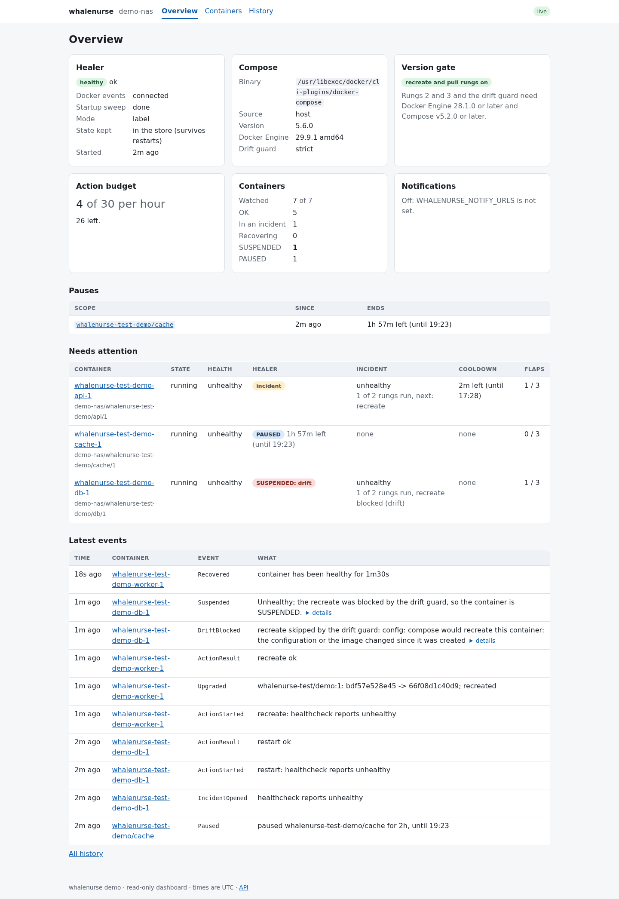

<p align="center">
  
</p>

# dokdosta

**Compose-aware self-healing for Docker hosts.**

*Dok dosta* is Serbo-Croatian for "until enough": it heals until it has tried enough, then stops and tells you. It was
called whalenurse up to 0.2.0; [upgrading.md](docs/upgrading.md#from-whalenurse-020-and-earlier) lists what to rename.

[](https://github.com/jackspiering/dokdosta/actions/workflows/ci.yml)
[](LICENSE)

Docker doesn't restart unhealthy containers, and a restart policy gives up when a start fails. dokdosta watches the
containers you opt in. When one turns unhealthy or stays down, it restarts it. If that doesn't help, it recreates it from the
stack's own compose files, sidecars included. If that fails too, it stops, tells you why, and leaves the container alone.

It won't deploy something new by accident: before a recreate it checks that your compose file and image still match what's
running, and it never pulls unless you ask. (For a service that shares another container's network, ipc or pid namespace, or
uses `volumes_from`, the compose file is checked only when it is healing itself and its parent is current; when it is repaired
after its parent was recreated, an edit to its own definition that you have not deployed is deployed. See
[labels.md](docs/labels.md#sidecars).)

<p align="center">
  <picture>
    <source media="(prefers-color-scheme: dark)" srcset="docs/screenshots/overview-desktop-dark.png">
    
  </picture>
</p>

## Try it in 2 minutes

On a fresh VM or laptop with Docker (not a host that already runs dokdosta):

```sh
git clone --depth 1 https://github.com/jackspiering/dokdosta && cd dokdosta/examples/demo
printf 'DOCKER_GID=%s\nDEMO_DIR=%s\n' "$(stat -c %g /var/run/docker.sock)" "$PWD" > .env
docker compose up -d
```

Then break the demo container so a restart can't fix it, and watch:

```sh
docker compose exec bop bop unhealthy sticky=true
docker compose logs -f dokdosta
```

Within a minute dokdosta restarts bop, then recreates it, then repairs the sidecar behind it. The dashboard is at
http://localhost:8484. `docker compose down -v` cleans up.

> If the compose plugin isn't at `/usr/libexec/docker/cli-plugins/docker-compose`, set `COMPOSE_PLUGIN` in `.env`.

## Use it

1. Run it as a container ([minimal](examples/minimal/compose.yaml), [full](examples/full/compose.yaml)) or
   [under systemd](docs/deployment.md#under-systemd). Start with `DOKDOSTA_DRY_RUN=true`.
2. Opt containers in:
   ```yaml
   labels:
     dokdosta.enable: "true"
   ```
3. Check it with `docker exec dokdosta /dokdosta status`.

The same CLI pauses healing during maintenance (`pause <project>/<service> --for 2h`) and lets dokdosta try again on a
container it gave up on (`unsuspend <project>/<service>`).

Notifications go through [Shoutrrr](https://nicholas-fedor.github.io/shoutrrr/) (ntfy, Gotify, Discord, Telegram and more).
Every setting is in [docs/configuration.md](docs/configuration.md) and every label in [docs/labels.md](docs/labels.md).

## Good to know

- **Mounting `docker.sock` gives dokdosta root on the host.** Read [docs/security.md](docs/security.md) before you deploy it.
- Restarting needs Docker Engine 25 or later. Recreating needs Engine 28.1 and Docker Compose v5.2.0 or later.
- To recreate from inside a container, dokdosta needs your stacks mounted read-only at the same path as on the host. See
  [docs/deployment.md](docs/deployment.md).
- A host reboot or daemon restart isn't treated as a crash.
- The pull rung can log in to a private registry only through a read-only `config.json` of inline credentials ([security.md](docs/security.md#private-registries)), and one dokdosta watches one host.

## Documentation

[Deployment](docs/deployment.md) · [Configuration](docs/configuration.md) · [Labels](docs/labels.md) ·
[Security](docs/security.md) · [Troubleshooting](docs/troubleshooting.md) · [Upgrading](docs/upgrading.md) ·
[Verifying a release](docs/verifying-releases.md) · [Changelog](CHANGELOG.md) · [Contributing](CONTRIBUTING.md) ·
[Design notes](docs/PLAN.md)

## License

MIT
